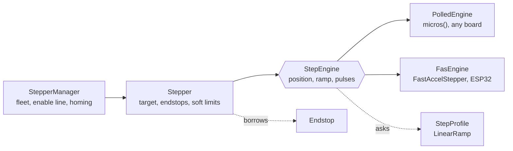

# MotorControl

[](https://github.com/AndrewwSSS/MotorControl/actions/workflows/check.yml)
[](LICENSE)


A header-only Arduino / PlatformIO library that drives a fleet of servos and
stepper axes without blocking `loop()`: endstops, two-pass homing, speed ramps,
soft limits and idle power release, with the pulse generation swappable per axis.
It runs two robotic arms and a CNC-shield test rig.

<!-- Demo GIF goes here:  -->

## Features

- **Non-blocking fleet control.** One `update()` per `loop()` moves every axis;
  moves on several axes start together and interleave their pulses.
- **Pluggable step engines.** The same axis logic runs on a polled `micros()`
  loop on any board, or on [FastAccelStepper](https://github.com/gin66/FastAccelStepper)
  with pulses and ramps in hardware on the ESP32.
- **Endstops and homing.** NO/NC switches with debounce. Homing does a fast seek,
  backs off, then re-approaches slowly for a repeatable zero, and reports which
  stage failed.
- **Speed profiles.** A linear ramp out of the box; write your own (S-curve,
  lookup table) by implementing one method.
- **Soft limits** per axis, armed once the position is known.
- **Idle power release.** The shared enable line drops after a quiet period and
  comes back before the next move, without sending pulses into a waking driver.
- **Servos too.** Hobby servos (`Servo` / `ESP32Servo`) and PCA9685 boards,
  managed the same way as steppers.
- **Driver-agnostic.** A4988, DRV8825, TB6600, DM542: any step+dir driver, with
  its pulse width and DIR setup time configurable.

## Quick start

`platformio.ini`:

```ini
lib_deps = https://github.com/AndrewwSSS/MotorControl.git
```

Two axes on a CNC shield, one homed against a limit switch, both under a ramp:

```cpp
#include <Endstop.h>
#include <Homing.h>
#include <LinearRamp.h>
#include <StepDirStepper.h>
#include <StepperManager.h>

Endstop xMin(9, Endstop::NORMALLY_CLOSED, Endstop::MIN);
LinearRamp ramp(/*startIntervalUs*/ 1000, /*rampSteps*/ 1000);
StepperManager axes(2, /*shared enable pin*/ 8);

void setup() {
    auto* x = new StepDirStepper(/*step*/ 2, /*dir*/ 5, /*stepsPerRev*/ 3200,
                                 StepDirStepper::NO_ENABLE_PIN, /*stepIntervalUs*/ 200);
    x->setEndstop(&xMin);
    axes.addMotor(x);
    axes.addMotor(new StepDirStepper(3, 6, 3200, StepDirStepper::NO_ENABLE_PIN, 200));

    axes.setProfiles(&ramp);
    axes.begin();
    axes.home(0, { Endstop::MIN, /*rest*/ 200, /*maxSteps*/ 20000,
                   /*backoff*/ 40, /*slowIntervalUs*/ 4000 });

    axes.moveToStep(0, 3200);   // both start now and run together
    axes.moveToStep(1, -1600);
}

void loop() {
    axes.update();              // call every iteration; never blocks
}
```

More in [`examples/`](examples): [Steppers](examples/Steppers/Steppers.ino),
[Servos](examples/Servos/Servos.ino) and [FasEngine](examples/FasEngine/FasEngine.ino).

## How it is built



A `Stepper` decides *what* an axis should do; a `StepEngine` decides *how* its
pulses are made. Endstops, homing, ramps and the fleet only talk to the
interfaces, so a new engine (for example a hardware-timer one) needs no change
anywhere else. Servos have their own root, `AngularMotor`, and share the same
`MotorManager<T>`. See [Architecture](docs/architecture.md).

## Documentation

| Guide | Covers |
| --- | --- |
| [Usage](docs/usage.md) | Servo and stepper fleets step by step: PCA9685, several axes, TB6600 timing |
| [Engines](docs/engines.md) | Choosing how pulses are made, driver STEP/DIR timing |
| [Ramping](docs/ramping.md) | Speed profiles, ramped stops, `onReached()` |
| [Endstops and homing](docs/homing.md) | Limit switches, the two-pass homing search |
| [Releasing the coils](docs/power.md) | Idle power release on a shared enable line |
| [Logging](docs/logging.md) | Compile-time log levels and the output stream |
| [Architecture](docs/architecture.md) | File layout, the two roots, adding a motor type or manager |

## Tests

130 unit tests run on the host against a fake Arduino core, so the stepping,
endstop, ramp and homing logic is checked without a board. CI also builds every
example for the Uno and the ESP32.

```sh
pio test -e native     # unit tests only
scripts/check.sh       # unit tests, plus the examples built for each board
```

`test/fake/FakeEngine.h` is a `StepEngine` with no pins, for testing `Stepper`,
homing and the fleet on their own.

## License

[MIT](LICENSE)
